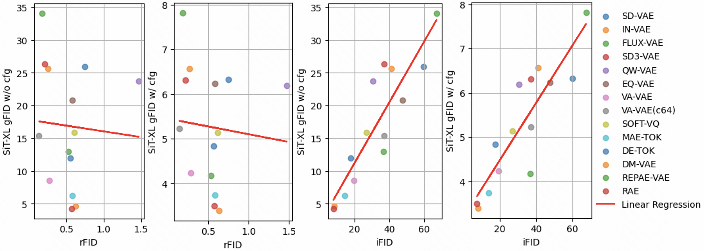

# Making Reconstruction FID Predictive of Diffusion Generation FID

[Paper](https://arxiv.org/abs/2603.05630v2) · [Benchmark](https://tongdaxu.github.io/pages/ifid.html) · [Checkpoints](https://huggingface.co/xutongda/Making-rFID-Predictive-of-Diffusion-gFID)

Official implementation of **interpolated FID (iFID)**. iFID measures the quality of decoded interpolations between nearby image latents to predict downstream diffusion generation quality.



## Setup

Tested on Linux with an A800, Python 3.12, PyTorch 2.4.0 and CUDA 12.1.

```bash
pip install -r requirements.txt
pip install -e .
```

Prepare ImageNet as follows. Evaluation resizes and center-crops images to 256×256.

```text
ImageNet/
  train/<class>/*.JPEG
  val/<class>/*.JPEG
```

VAE configs are in `configs/`. Some models require additional dependencies or local weight paths; check the selected config before running.

## iFID and VAE metrics

```bash
accelerate launch --multi_gpu --num_processes=4 evalvae.py \
  --vae-config=configs/SDVAE.yaml \
  --dataset=ImageNet/val --dataset-ref=ImageNet/train \
  --exp-name=ifid-sdvae --sample-dir=samples \
  --intp=slerp --alpha=0.5 --top=10 --bs=25 --seed=0
```

This prints **iFID, rFID, PSNR, SSIM, MS-SSIM and LPIPS**. This command uses the full training reference bank and validation set, SLERP at 0.5, top-10 candidates, and search across classes. The paper describes the reference bank as 1000k images and the source set as 50k images; the command does not cap the training split at exactly one million images.

- For one GPU, replace `accelerate launch --multi_gpu --num_processes=4` with `python`.
- Add `--small=128 --small_val=64 --bs=8` for a quick check. Subset scores are not benchmark scores.
- Add `-save` to save originals, reconstructions, neighbors and interpolations.
- Add `-cpu` to store the latent bank in CPU memory. Computation still needs a GPU; bfloat16 storage can change the score.
- `--intp=linear` and `--intp=mask` select the other interpolation methods.

For reconstruction only:

```bash
python evalvaefast.py --vae-config=configs/SDVAE.yaml \
  --dataset=ImageNet/val --bs=25
```

This prints rFID, PSNR and LPIPS. **The two evaluators use different PSNR/LPIPS input-range conventions:** `evalvae.py` passes `[0,1]` images with `zero_mean=True`, whereas `evalvaefast.py` uses `False`. Their PSNR/LPIPS values should not be compared directly; this does not affect iFID/rFID.

## Inference

Download the released SD-VAE / SiT-B checkpoint:

```bash
hf download xutongda/Making-rFID-Predictive-of-Diffusion-gFID \
  --include 'sit-b-sdvae-400k/*' --local-dir=pretrained
```

Generate four images:

```bash
torchrun --standalone --nproc_per_node=1 generate.py \
  --exp-path=pretrained/sit-b-sdvae-400k --train-steps=400000 \
  --vae-config=configs/SDVAE.yaml --sample-dir=samples \
  --num-fid-samples=4 --pproc-batch-size=4 \
  --mode=sde --num-steps=250 \
  --cfg-scale=1.0 --guidance-low=0.0 --guidance-high=1.0 --skip-fid
```

Images are saved under `samples/<experiment>_<step>_cfg.../`. Keep `args.json` alongside the checkpoint directory. `--vae-config` overrides the VAE path saved during training. CFG scale 1 disables guidance.

To compute gFID, remove `--skip-fid`, set `--num-fid-samples=50000`, and provide `--fid-reference-file` with the [ImageNet-256 reference NPZ](https://openaipublic.blob.core.windows.net/diffusion/jul-2021/ref_batches/imagenet/256/VIRTUAL_imagenet256_labeled.npz). Add `--keep-samples` to retain PNGs after evaluation. Alternatively, `--fid-reference-folder` accepts a flat image directory. Use a separate sample directory for each run.

## Training

Convert the training set to HDF5 at 256×256:

```bash
python preprocessing.py --imagenet-path=ImageNet/train \
  --output-path=ImageNeth5 --resolution=256
```

Train SiT-B with a frozen SD-VAE for 40 epochs (paper Appendix B.1):

```bash
accelerate launch --multi_gpu --num_processes=4 train.py \
  --data-dir=ImageNeth5 --vae-config=configs/SDVAE.yaml \
  --model=SiT-B/2 --batch-size=128 --epochs=40 --max-train-steps=1000000 \
  --mixed-precision=no --allow-tf32 --bn-momentum=0.1 \
  --output-dir=exps --exp-name=sit-b-sdvae --report-to=wandb
```

Training stops at the epoch or step limit, whichever comes first; the step limit above allows 40 full epochs at batch 128. Increase the step limit if reducing the batch size. Batch size is global. For a single A800, use `python train.py` and a smaller batch; SD-VAE / SiT-B was tested at batch 32. Set `WANDB_MODE=offline` for local logging. Use the config table below to choose `/1` or `/2` for 256 spatial tokens, or `/1D` for token latents. Training and sampling apply the latent-dimension time shift automatically. The implementation uses AdamW with weight decay 0 (the paper calls this Adam).

Checkpoints are saved every 50,000 steps under `exps/<exp-name>/checkpoints/`, with `args.json` in the experiment directory. To resume, add `--resume-step=50000 --continue-train-exp-dir=exps/<exp-name>`. The target step count is total, not additional. The epoch limit starts again on resume. Resume restores model, EMA and optimizer, but not RNG or data-loader state.

<details>
<summary>Tested paths</summary>

Single-A800 checks covered SD-VAE iFID, reconstruction metrics, SDE/ODE sampling, CFG, FID, SiT-B/XL training and resume, plus MAE-TOK iFID and SiT-B/1D training/inference. These were small execution tests, not full ImageNet benchmark reruns. Other model pairs and multi-GPU execution have not been individually checked.

</details>

## Other VAE metrics

The additional evaluators are in `metrics/` (from the `mwhe` branch).

| Metric | Entry point | Notes |
| --- | --- | --- |
| EQ | `python -m metrics.eval_eq` | Equivariance; uses VGG LPIPS |
| SE | `python -m metrics.eval_se` | Scale equivariance; default scale 2 |
| VF | `python -m metrics.eval_vf` | DINOv2/MAE alignment; includes projection calibration |
| GMM | `python -m metrics.eval_gmm` | Latent reduction and mixture fitting |

```bash
pip install -r requirements-metrics.txt
python -m metrics.eval_eq --vae-config=configs/SDVAE.yaml \
  --base-path=ImageNet/val --bs=8
```

All four accept `--vae-config` and `--base-path`. Run each entry point with `--help` for its settings. These evaluators were checked with SD-VAE on small subsets. `train.py` also logs diffusion loss during training.

## Paper results

From [Table 2 of the paper (v2)](https://arxiv.org/html/2603.05630v2#S4.T2). Each cell is **PCC / SRCC** with diffusion gFID; higher is better. The study uses 13 VAEs, excluding RAE for SiT-B and 1D latents for EQ/SE. `*` denotes p < 0.05.

| VAE metric | SiT-B, no CFG | SiT-B, CFG | SiT-XL, no CFG | SiT-XL, CFG |
| --- | ---: | ---: | ---: | ---: |
| −PSNR | −0.81<sup>*</sup> / −0.81<sup>*</sup> | −0.83<sup>*</sup> / −0.82<sup>*</sup> | −0.79<sup>*</sup> / −0.78<sup>*</sup> | −0.79<sup>*</sup> / −0.85<sup>*</sup> |
| −SSIM | −0.78<sup>*</sup> / −0.81<sup>*</sup> | −0.80<sup>*</sup> / −0.84<sup>*</sup> | −0.77<sup>*</sup> / −0.78<sup>*</sup> | −0.77<sup>*</sup> / −0.85<sup>*</sup> |
| LPIPS | −0.73<sup>*</sup> / −0.74<sup>*</sup> | −0.72<sup>*</sup> / −0.76<sup>*</sup> | −0.73<sup>*</sup> / −0.72<sup>*</sup> | −0.73<sup>*</sup> / −0.79<sup>*</sup> |
| rFID | −0.04 / −0.31 | −0.07 / −0.31 | −0.06 / −0.21 | −0.15 / −0.31 |
| Diffusion Loss | 0.21 / 0.24 | 0.22 / 0.20 | 0.34 / 0.37 | 0.24 / 0.29 |
| EQ Loss | −0.62 / −0.52 | −0.78<sup>*</sup> / −0.76<sup>*</sup> | −0.39 / −0.15 | −0.37 / −0.13 |
| SE Loss | −0.70<sup>*</sup> / −0.70<sup>*</sup> | −0.75<sup>*</sup> / −0.83<sup>*</sup> | −0.77<sup>*</sup> / −0.70 | −0.79<sup>*</sup> / −0.79 |
| VF Loss | 0.10 / 0.05 | 0.09 / 0.03 | 0.17 / 0.11 | 0.09 / −0.01 |
| GMM Loss | 0.25 / 0.04 | 0.25 / 0.05 | 0.28 / 0.01 | 0.23 / −0.02 |
| **iFID (ours)** | 0.85<sup>*</sup> / 0.86<sup>*</sup> | 0.82<sup>*</sup> / 0.84<sup>*</sup> | 0.89<sup>*</sup> / 0.91<sup>*</sup> | 0.88<sup>*</sup> / 0.92<sup>*</sup> |

Paper sampling uses Euler SDE with 250 steps. For CFG, the paper reports the best gFID over scales 1.0–6.0 in steps of 0.25; a single CFG setting does not reproduce that search.

## Model configs

| VAE | VAE config | SiT variant (XL / B) |
| --- | ---: | ---: |
| SD-VAE | [SDVAE.yaml](configs/SDVAE.yaml) | `/2` |
| FLUX-VAE | [FLUXVAE.yaml](configs/FLUXVAE.yaml) | `/2` |
| QW-VAE | [QWVAE.yaml](configs/QWVAE.yaml) | `/2` |
| SD3-VAE | [SD3VAE.yaml](configs/SD3VAE.yaml) | `/2` |
| IN-VAE | [INVAE.yaml](configs/INVAE.yaml) | `/1` |
| VA-VAE | [VAVAE.yaml](configs/VAVAE.yaml) | `/1` |
| VA-VAE (c64) | [VAVAE64.yaml](configs/VAVAE64.yaml) | `/1` |
| SOFT-VQ | [SOFTVQ.yaml](configs/SOFTVQ.yaml) | `/1D` |
| MAE-TOK | [MAETOK.yaml](configs/MAETOK.yaml) | `/1D` |
| DE-TOK | [DETOK.yaml](configs/DETOK.yaml) | `/1D` |
| DM-VAE | [DMVAE.yaml](configs/DMVAE.yaml) | `/1D` |
| REPAE-VAE | [REPAEVAE.yaml](configs/REPAEVAE.yaml) | `/2` |
| RAE | [RAE.yaml](configs/RAE.yaml) | `/1` |

`QwenImg-VAE` corresponds to `QWVAE.yaml`, and `REPAE-SDVAE` to `REPAEVAE.yaml`. `EQVAE.yaml` is absent from this branch; `mwhe/configs/EQVAE.yaml` exists but points to a machine-local checkpoint. `RAE.yaml` points to `/mnt/task_runtime/configs/rae_DINOv2-B.yaml`; adapt this and nested weight paths before use. See “Tested paths” above for the validation scope.

## Acknowledgments

The SiT training and sampling code builds on [REPA-E](https://github.com/End2End-Diffusion/REPA-E). VAE implementations build on their upstream projects, including [continuous_tokenizer](https://github.com/Hhhhhhao/continuous_tokenizer), [RAE](https://github.com/bytetriper/RAE), [DMVAE](https://github.com/imantdaunhawer/DMVAE), [DeTok](https://github.com/Jiawei-Yang/DeTok), [UAE](https://github.com/WeichenFan/UAE), and [SVG](https://github.com/shiml20/SVG/tree/main).
